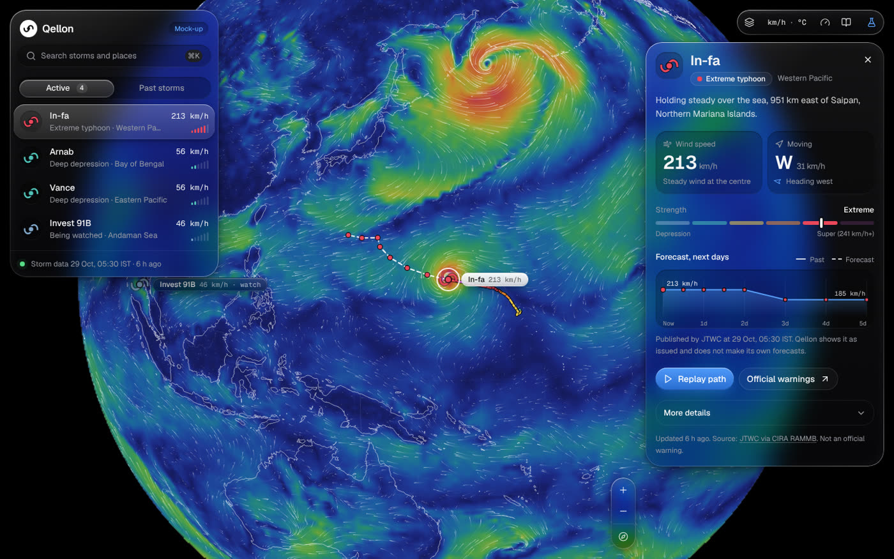

# Qellon Visualizer

A storm globe for everyone: every active cyclone, hurricane, typhoon and depression, with its name, plain-language strength,
wind speed, direction, past path and forecast path, on a moving wind map. Educational project, web only.

> **Status (29 Oct 2026): the app runs on live data and is ready to publish on Cloudflare Pages (day 3).
> Publishing starts once the Cloudflare secrets are added, see `docs/DEPLOY.md`.**
> It is not a warning service.
>
> The project name is a placeholder and will change.



## What the prototype does
- Globe with animated wind streaks and wind-speed colours (orthographic projection, canvas)
- Active storms with strength in words, wind speed, moving speed and direction, past and forecast path
- Click anywhere for local wind, temperature and pressure; unit switch (km/h, mph, kt, m/s; C/F; hPa/inHg; km/mi/nmi; local/UTC)
- Search (Ctrl/Cmd+K), layer toggles, phone layout
- Replay of past storms: Fani 2019, Amphan 2020, Dana 2024, Phailin 2013 (IBTrACS)
- Live data: loads `data/storms.json` on open and every 10 minutes, and `data/wind.json` (0.5° GFS) when it is published.
  Falls back to the copy built into the app, with a banner when the data can't be reached or is more than 6 hours old.
  Storms with no new report show as "Ended" or "Not updated"
- About and sources dialog with source status, credits and official agency links
- Liquid-glass interface, Geist type, shadcn/ui, spring-based motion

## Run it
```bash
cd app
npm ci
npm run dev        # http://localhost:5173
npm run build      # one self-contained file in app/dist/index.html
```
Needs Node 20+.

## Repository layout
| Path | What |
|---|---|
| `app/` | The web app (React 19, Vite, Tailwind 4, shadcn/ui). Version 3 of the mock-up |
| `pipeline/` | Storm data pipeline (Python 3.11+, standard library only), wind field builder (needs eccodes, numpy) and tests |
| `app/public/data/storms.json` | Live storm file written by the pipeline, refreshed every 3 hours. Also built into the app as the fallback |
| `app/public/data/wind.json` | 0.5° wind, temperature and pressure field. Built at deploy time, not committed |
| `.github/workflows/` | `refresh-storms.yml` (every 3 hours), `deploy.yml` (builds and publishes after each refresh and push to main) and `ci.yml` (tests and app build on every push) |
| `docs/DEPLOY.md` | How to connect Cloudflare Pages |
| `docs/LOOKS.md` | The eight looks, the Customize card and how the drawing engine fits in |
| `trigger/` | Cloudflare Worker that starts the storm refresh every 3 hours (GitHub's own timer is only a backup). Setup in `docs/TIMER.md` |
| `docs/research/` | Research, product plan, and the Phase 0 data spike with the v0.2 plan |
| `docs/ATTRIBUTION.md` | Data sources, licences and credits |
| `data/fixtures/2026-10-29/` | Responses saved from NHC, GDACS, NOAA tcvitals, GFS and IBTrACS, for tests and offline work |
| `tools/` | Scripts for replay tracks, the GFS wind grid and browser tests (`tools/e2e/live.cjs` data states, `tools/e2e/devices.cjs` screen sizes and keyboard) |

## Storm data pipeline
```bash
python3 -m pipeline.storms --out app/public/data/storms.json          # live: NHC, GDACS, NOAA tcvitals
python3 -m unittest discover -s pipeline/tests -t .                     # tests on saved responses
# offline, from the saved responses:
python3 -m pipeline.storms --out /tmp/storms.json --previous /dev/null \
  --fixtures data/fixtures/2026-10-29 --now 2026-10-29T08:30:00Z
# wind field from the newest GFS run (pip install eccodes numpy), about 1.4 MB:
python3 -m pipeline.wind --out app/public/data/wind.json
```
Sources and how they are combined: `docs/research/04-data-sources-v0.3.md`.

## Rebuilding the other data files from the fixtures
```bash
python3 tools/build_past.py   data/fixtures/2026-10-29/ibtracs/NI.header-and-4-storms.csv app/src/data/pastStorms.json
# built-in 1° GFS wind grid, used until data/wind.json loads (needs: pip install eccodes numpy)
python3 tools/decode_gfs.py   data/fixtures/2026-10-29/gfs/gfs_2026102900.grb2 app/src/data/gfs.json
```

## Next
1. ~~Live storm pipeline with fallback and tests~~ (done)
2. ~~App reads the live file; real stale and error states; About and credits; 0.5° wind field~~ (done)
3. ~~Deploy workflow for Cloudflare Pages with the wind field built at each deploy; screen-size and keyboard checks~~ (done)
4. Add the Cloudflare secrets and publish; check in Safari and Firefox on real devices
5. Pick a name

## Licence
Code: MIT, see `LICENSE`. Data keeps its sources' terms, see `docs/ATTRIBUTION.md`.

## Not an official warning
Qellon shows data as published by weather agencies and does not make its own forecasts. Follow your national agency for warnings.
